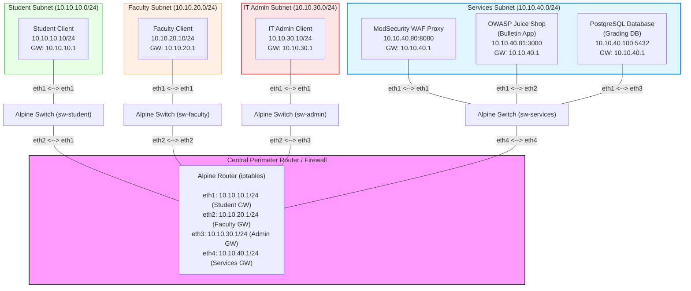

# iptables-firewall-simulation-lab
## Obective:
In this lab, I create a network design for a single campus simulation using Containerlab, Alpine Linux switches, iptables, and OWASP ModSecurity WAF.

It is a 4-subnet campus environment connecting Students, Faculty, IT Admin staff and Centralized Serices. The network requires Layer 3/4 Packet Filtering Firewalls on the central router and Layer 7 Web Application Firewall to defend against web exploits. 

The network meets the following topology:

---
## Requirements to Demo this Lab
This lab was created inside Containerlabs and is meant to be run within Linux or WSL. The YAML file and config files are available from the repository.

# Running the Lab
## Building the Custom Images
This lab makes use of two custom Docker images. The following commands must be entered before deploying the lab:
```
docker build -t custom-juiceshop:latest ./images/juiceshop
```
```
docker build -t custom-waf:latest ./images/modsec
```

## Deploying the Lab
Open Containerlabs and navigate to the downloaded YAML file, then run the following command:
```
sudo containerlab deploy -t lab.clab.yml
```
## Testing the Firewall
To test connections between subnets on the network, run the following commands:

### **Test 1: Legitimate Bulletin Web Access (Student to WAF)**
* **Command:** `docker exec -it clab-campus-network-security-student-client curl -s -o /dev/null -w "%{http_code}" http://10.10.40.80:8080/`
* **Expected Result:** `200`

### **Test 2: ModSecurity WAF Interception of SQL Injection**
* **Command:** `docker exec -it clab-campus-network-security-student-client curl -s -o /dev/null -w "%{http_code}" "http://10.10.40.80:8080/rest/user/login?email='OR'1'='1"`
* **Expected Result:** `403`

### **Test 3: Authorized Grading DB Access (Faculty Subnet)**
* **Command:** `docker exec -it clab-campus-network-security-faculty-client nc -zv -w 3 10.10.40.100 5432`
* **Expected Result:** `open` / connection succeeded

### **Test 4: Unauthorized Grading DB Access Block (Student Subnet)**
* **Command:** `docker exec -it clab-campus-network-security-student-client nc -zv -w 3 10.10.40.100 5432`
* **Expected Result:** Connection timeout / failure

### **Test 5: SSH Privilege Validation (IT Admin Host Allowed)**
* **Command:** `docker exec -it clab-campus-network-security-admin-client nc -zv -w 3 10.10.40.100 22`
* **Expected Result:** Connection refused (packet reaches target, confirming rule allows traversal, but port 22 is unlistened on DB)

### **Test 6: SSH Privilege Restriction (Student Host Blocked)**
* **Command:** `docker exec -it clab-campus-network-security-student-client nc -zv -w 3 10.10.40.100 22`
* **Expected Result:** Connection timeout / failure (dropped by router firewall)
---
## Destroying the Lab
Once you've finished with the lab, run the following command to destroy and clean-up:
```
sudo containerlab destroy -t lab.clab.yml
```
